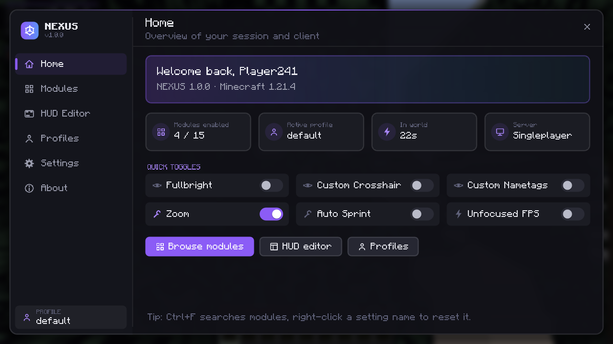
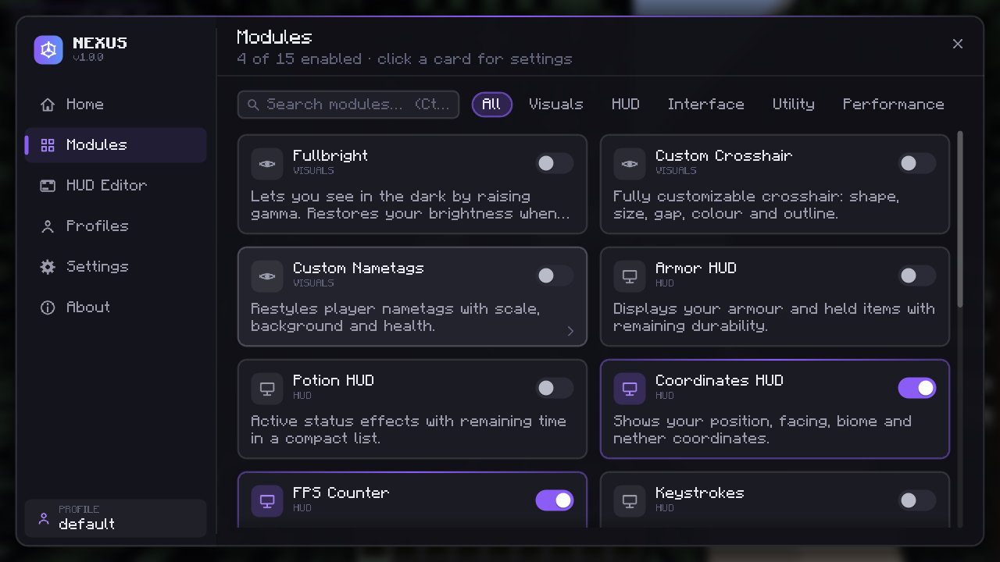
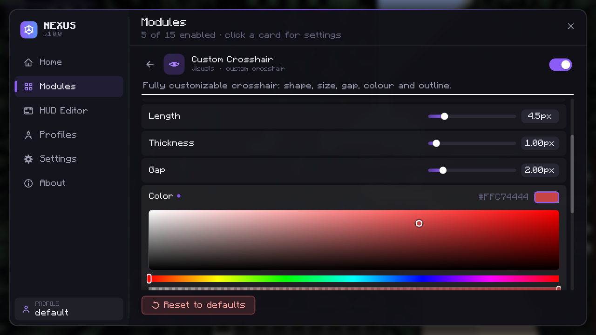
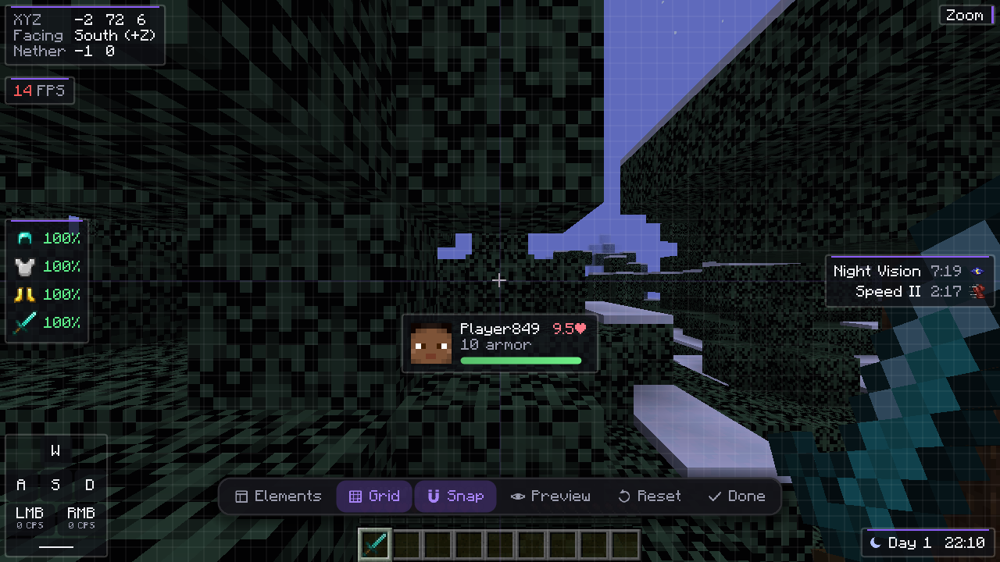
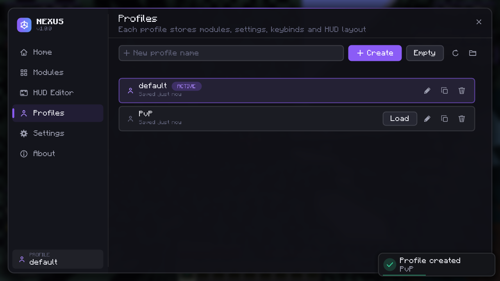
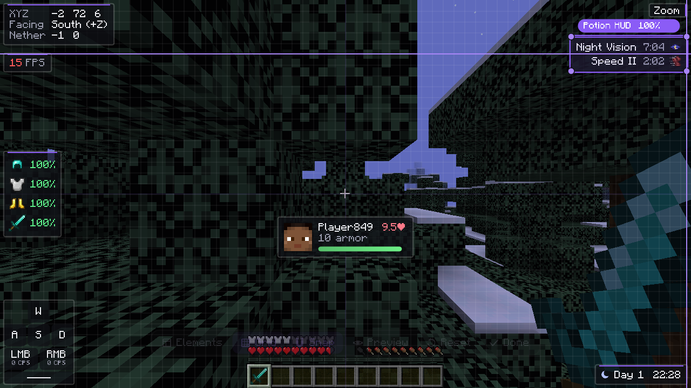

# NEXUS Client

Клиентский utility-мод для **Minecraft Java 1.21.11** на **Fabric**. Минималистичный интерфейс: тёмный графит, полупрозрачные панели, скругления, фиолетовый или голубой акцент и плавные анимации, привязанные к реальному времени.



| Модули | Настройки модуля |
|---|---|
|  |  |

| Редактор HUD | Профили |
|---|---|
|  |  |

---

## Требования

| Компонент | Версия |
|---|---|
| Minecraft | 1.21.11 (ровно эта версия: в `fabric.mod.json` зависимость `"minecraft": "1.21.11"`) |
| Fabric Loader | ≥ 0.19.5 |
| Fabric API | 0.141.6+1.21.11 (или новее для 1.21.11) |
| Java | 21 |

Сторонних библиотек нет. JSON обрабатывается через Gson, который поставляется вместе с Minecraft. Интерфейс — Minecraft GUI API (`Screen`, `DrawContext`) плюс собственный рендер фигур (`render/Render2D`).

## Сборка

```bash
./gradlew build            # Linux / macOS
gradlew.bat build          # Windows
```

Результат: **`build/libs/nexus-client-1.0.1+mc1.21.11.zip`** — готовый мод. Сборка намеренно не создаёт `.jar`-файлов: мод Fabric — это zip-архив, а расширение `.jar` нужно только самому файлу в папке `mods` (Fabric Loader загружает только `*.jar`). Его выставляет установка (см. ниже).

- Нужен JDK 21 (`JAVA_HOME=/path/to/jdk21 ./gradlew build`, если в системе другая версия).
- `gradle-wrapper.jar` в проекте нет. `gradlew` / `gradlew.bat` — короткие скрипты: они скачивают официальный дистрибутив Gradle из `gradle/wrapper/gradle-wrapper.properties`, проверяют его SHA-256 (`distributionSha256Sum`) и распаковывают в `~/.gradle/nexus-dists/`. Для `gradlew.bat` нужен PowerShell 5+ (есть в Windows 10/11). IntelliJ IDEA читает тот же `gradle-wrapper.properties` и тоже работает без jar.
- Запуск игры из среды разработки: `./gradlew runClient`.
- Стек: Gradle 9.2.1, Fabric Loom 1.14.10, Yarn `1.21.11+build.6`.

## Установка

Проще всего — через **NEXUS Launcher**: он ставит мод в сборку Fabric 1.21.11 сам и обновляет его.

Вручную (официальный лаунчер и любые другие):
1. Установите [Fabric Loader](https://fabricmc.net/use/) 0.19.5 или новее для 1.21.11 и Fabric API для 1.21.11.
2. Установите мод одной командой:
   ```bash
   ./gradlew installMod                                  # в %APPDATA%\.minecraft\mods (или ~/.minecraft/mods)
   ./gradlew installMod -PmodsDir="D:/Games/pack/mods"   # в другую папку mods
   ```
   Команда копирует пакет в папку как `nexus-client-1.0.1+mc1.21.11.jar` и удаляет старые версии NEXUS Client. Можно и руками: скопировать `.zip` в `mods` и переименовать в `.jar`.
3. Запустите профиль Fabric. Меню открывается клавишей **Right Shift**.

---

## Возможности

### Меню NEXUS (Right Shift)
- Оформлено в стиле NEXUS Launcher: боковая панель с фирменным блоком, навигация «таблетками» с плавной подсветкой выбранного раздела и наведения, карточка игрока со скином и активным профилем, крупный заголовок страницы, мягкое акцентное свечение за окном.
- Разделы: **Home**, **Modules**, **HUD Editor**, **Profiles**, **Settings**, **About**. Переход между ними анимирован (сдвиг и затухание).
- Поиск по названию, id и описанию модуля (`Ctrl+F`). Фильтр по категориям.
- Переключатели прямо на карточках:
  - клик по карточке открывает настройки модуля;
  - средний клик переключает модуль.
- Home: сводка сессии и быстрые переключатели.
- About: реальные версии Minecraft, Loader, Fabric API и Java, кнопка «Open config folder».
- Масштабирование:
  - окно подстраивается под разрешение и GUI scale;
  - на маленьких экранах включается компактный режим;
  - отдельная настройка *Menu scale*.
- Esc работает по слоям: закрыть настройки модуля → очистить поиск → закрыть меню.
- Правый клик по названию настройки сбрасывает её к значению по умолчанию. Изменённые настройки помечены точкой.

### Оформление Minecraft (только версия для 1.21.11)
Вся ванильная логика остаётся прежней, меняется только внешний вид. Поэтому работают демо-режим, блокировка сетевой игры, уведомления Realms и кнопки, которые добавляют другие моды.
- **Главное меню игры:**
  - логотип NEXUS по центру со свечением, подпись «CLIENT · MINECRAFT 1.21.11», ванильная splash-фраза;
  - фон — **анимированные фото** (см. ниже) или, если фото выключены, вращающаяся панорама с размытием; поверх — затемнение, медленно плавающие акцентные блики и частицы;
  - приветствие по времени суток с ником и головой скина;
  - колонка кнопок: «Одиночная игра» выделена акцентным градиентом, ниже сетевая игра, Realms, кнопка Mod Menu (если он установлен) и кнопка **NEXUS Client**, открывающая меню NEXUS;
  - кнопки появляются по очереди с плавной анимацией;
  - внизу слева версии NEXUS и Minecraft, ванильная строка копирайта Mojang сохранена.
- **Фото на фоне меню (слайд-шоу):**
  - в мод встроено 15 скриншотов Minecraft (`assets/nexus/backgrounds/bg_01…bg_15.jpg`);
  - свои фото: положите PNG/JPG в `.minecraft/config/nexus/backgrounds/` (кнопка *Settings → Background photos* открывает папку). Если там есть хотя бы одно фото, показываются только ваши, встроенные — нет. Папка перечитывается при каждом открытии главного меню, перезапуск не нужен;
  - анимация: медленное приближение/отдаление и сдвиг кадра (эффект Ken Burns, у каждого фото своё направление), плавная смена фото (1,6 с), лёгкий параллакс за мышью; первое фото проявляется из темноты;
  - фото показывается и на других экранах вне мира (выбор мира, настройки и т. д.) — там оно размыто, как ванильная панорама;
  - настройки (*Settings → Main menu background*): Photos / Panorama, время показа одного фото (4–30 с, по умолчанию 9), движение, параллакс, случайный порядок (включён по умолчанию), затемнение (0–80 %, по умолчанию 25 %). При *Animation speed* 10× фото не двигаются и сменяются без перехода;
  - память: одновременно загружено не больше двух фото (текущее и следующее), декодирование (stb_image из LWJGL, без сторонних библиотек) идёт в фоновом потоке, фото уменьшается примерно до разрешения окна; при входе в мир текстуры освобождаются. Повреждённые файлы пропускаются с записью в лог, файлы больше 48 МБ не загружаются, учитываются первые 64 фото.
- **Меню паузы:**
  - стеклянная панель с шапкой NEXUS;
  - кнопка **NEXUS Client** под «Вернуться к игре»;
  - строка с головой скина, ником, местом игры (одиночная игра или имя сервера) и FPS.
- **Все ванильные экраны** (настройки, выбор мира и сервера, создание мира, управление, наборы ресурсов и т. д.):
  - кнопки, переключатели, ползунки, поля ввода, чекбоксы и вкладки нарисованы в стиле NEXUS со скруглениями, акцентной подсветкой и плавным наведением;
  - фон меню — графитовый градиент вместо тёмной текстуры;
  - списки с акцентными разделителями, рамкой выбора и тонкой полосой прокрутки.
- Цвета берутся из акцента NEXUS (*Settings → Accent*). Смена акцента сразу перекрашивает и ванильные экраны.
- Вернуть ванильное оформление нельзя — так было решено.
- Новые строки главного меню переведены на русский и английский (`assets/nexus/lang`). Ванильные надписи переводит сама игра.

### Модули (15)

| Категория | Модуль | Основные настройки |
|---|---|---|
| Visuals | **Fullbright** | Brightness, Smooth transition. Исходная гамма восстанавливается при выключении и при выходе из игры и не записывается в `options.txt`. |
| Visuals | **Custom Crosshair** | Style, Length, Thickness, Gap, Color, Outline (цвет, ширина), Dynamic gap, Target color, Attack indicator |
| Visuals | **Custom Nametags** | Scale, Background (+цвет), Show health, Health format, Text shadow |
| HUD | **Armor HUD** | Layout, Slots (мультивыбор), Durability (Percent / Value / Bar / Hidden), Colored durability |
| HUD | **Potion HUD** | Icons, Show level, Compact, Sort, Hide vanilla icons, Blink when ending |
| HUD | **Coordinates HUD** | Format (пресеты), **Template** со своим форматом (`{x} {y} {z} {dir} {biome}`), Decimals, Facing, Nether coordinates, Biome |
| HUD | **FPS Counter** | Label, Frame time, Color by value |
| HUD | **Keystrokes** | Mouse buttons, CPS, Space bar, Key size, Spacing, Pressed color |
| HUD | **Target HUD** | Target source, Hide after, Portrait, Distance, Armor |
| HUD | **World Time HUD** | Clock format, Day counter, Sun/moon icon, Weather, Moon phase, Real time |
| HUD | **Module List** | Hide HUD modules, Sort, Accent bar, Lowercase |
| Interface | **Notifications** | Position, Duration, Module toggles |
| Utility | **Zoom** | Zoom key (по умолчанию C), Zoom, Smooth, Scroll to adjust, Cinematic camera |
| Utility | **Auto Sprint** | Без настроек. Спринт по ванильным правилам (голод, блоки, слепота, присед). |
| Performance | **Unfocused FPS** | FPS limit, когда окно не в фокусе |

У каждого HUD-элемента есть общие настройки: позиция (якорь и смещение), **Scale**, **Opacity**, **Background**. Стиль у всех один (`HudStyle`), его параметры задаются глобально в Settings: accent line, corner radius, text shadow.

### Редактор HUD
- Перетаскивание мышью. Масштаб меняется угловыми маркерами (противоположный угол остаётся на месте) или колесом над элементом (Shift — мелкий шаг). Выделенный элемент показан рамкой, маркерами углов и чипом с именем и масштабом.
- Привязка к краям и центру экрана и к краям/центрам других элементов, с направляющими линиями; затем — к сетке. Shift при перетаскивании или кнопка Snap отключают привязку. Сетка с настраиваемым шагом и перекрестие центра экрана.
- Элементы не уходят за экран: позиция ограничивается при перетаскивании, масштабировании, сдвиге стрелками и после смены разрешения или GUI scale. Позиция хранится относительно ближайшего якоря (край/центр).
- **Сохранение по элементам:** у каждого HUD-модуля своя запись в профиле (`"hud": {ax, ay, ox, oy}` + масштаб). После каждого перетаскивания/масштабирования запись сразу уходит в файл (асинхронно), при закрытии редактора — ещё раз.
- **Сброс:** R — выделенный элемент, Ctrl+R или Reset без выделения — все. **Предпросмотр** (P) прячет сетку и рамки и показывает HUD с реальными данными.
- **Без конфликтов с управлением Minecraft:** редактор — обычный `Screen`, поэтому, пока он открыт, игра не получает ни клавиш, ни мыши (персонаж не двигается, хотбар не листается). Все горячие клавиши редактора действуют только внутри него; Esc закрывает его по слоям (предпросмотр → окно Elements → редактор).
- Панель инструментов: **Elements** (включить/скрыть элементы), Grid, Snap, Preview, Reset, Done.
- Клавиши:

  | Клавиша | Действие |
  |---|---|
  | Стрелки (+Shift) | Сдвинуть на 1 px (10 px) |
  | R | Сбросить элемент |
  | Ctrl+R | Сбросить всё |
  | Del | Скрыть элемент |
  | G | Сетка |
  | P | Предпросмотр |

- Правый клик по элементу открывает его настройки.
- Без реальных данных (нет эффектов, цели, брони) элементы показывают образец содержимого.



### Настройки (типы)
`BooleanSetting`, `NumberSetting` (слайдер с шагом, Shift и колесо для точной настройки), `ModeSetting`, `ColorSetting` (HSV-пикер, альфа, HEX), `KeybindSetting`, `StringSetting` (с валидатором), `MultiSelectSetting`.

У каждой настройки есть id, имя, описание, значение по умолчанию, валидация (clamp/округление по шагу, допустимые значения) и слушатели `onChange`. Есть также условная видимость `visibleWhen`. UI обновляется сразу.

### Анимации (централизованная система, пакет `ui.animation`)
| Класс | Назначение |
|---|---|
| `AnimationClock` | единый источник времени: экраны и HUD вызывают `beginFrame()` в начале кадра, все анимации кадра видят одно и то же время; `wave()`/`blink()`/`holdThenFade()` для пульсации, мигания курсора и самоисчезающих подсказок |
| `Animation` | твин значения: длительность, кривая `Easing`, `animateTo` / `restart` / `set`, прогресс |
| `SmoothValue` | плавное следование за целью (экспоненциально, по реальному dt) — наведение, прокрутка, индикаторы |
| `Fade` | появление/исчезновение (прозрачность 0..1) с отдельными длительностями входа и выхода |
| `AnimatedRect` | анимация позиции и размера прямоугольника |
| `PageTransition` | переход страниц: уходящая страница гаснет и сдвигается, новая проявляется; направление по навигации |
| `ToggleAnimation` | анимация двухпозиционных элементов (переключатели) с лёгким «перелётом» `OUT_BACK` |
| `Easing` | linear, in/out/in-out quad, in/out/in-out cubic, out quart, in-out sine, out expo, out back |
| `AnimationSettings` | глобальный множитель скорости (*Settings → Animation speed*, 0.25–10×; 10× — анимации мгновенные) |

Всё считается от времени (`System.nanoTime` через `AnimationClock`), а не от числа кадров. Состояние анимаций — только примитивные поля: в цикле отрисовки они ничего не выделяют. Используют систему: окно меню NEXUS (`Fade`), переходы разделов (`PageTransition`), переключатели (`ToggleAnimation`), ModeSelector, карточки модулей, редактор HUD, уведомления, Target HUD, главное меню игры.

### Конфигурация и профили
- Папка `.minecraft/config/nexus/`:
  ```
  client.json            — активный профиль, тема, акцент, настройки UI/HUD-редактора
  profiles/<name>.json   — состояния модулей, настройки, бинды, позиции HUD
  backups/               — резервные копии повреждённых и мигрированных файлов
  ```
- Профили можно создавать, переименовывать, дублировать, удалять и переключать.
- Запись идёт в отдельном однопоточном IO-потоке: атомарная запись через временный файл и `ATOMIC_MOVE`. При выходе из игры запись синхронная.
- Повреждённый JSON переносится в `backups/*.corrupt-<время>.bak`. Затем загружаются значения по умолчанию, и показывается уведомление.
- Каждый файл хранит поле `schema`. `ConfigMigrator` поднимает старые схемы до текущей и перед этим делает резервную копию. Неизвестные ключи и некорректные значения игнорируются, вместо них берутся значения по умолчанию.

---

## Управление

| Действие | Клавиша |
|---|---|
| Открыть/закрыть меню | Right Shift (меняется в Settings → Menu key) |
| Поиск модулей | Ctrl+F |
| Переключение разделов | Ctrl+1…6 |
| Zoom | C (удерживать, колесо меняет кратность) |
| Бинд модуля | Настройки модуля → Keybind (Esc/Backspace очищает) |

---

## Структура проекта

```
nexus-client/
├── build.gradle, settings.gradle, gradle.properties, gradlew(.bat), gradle/wrapper/ (properties + bootstrap.ps1, без jar)
├── src/main/resources/
│   ├── fabric.mod.json, nexus.mixins.json, nexus.accesswidener
│   └── assets/nexus/ (icon.png, textures/gui/icons.png — атлас иконок)
├── tools/gen_icons.py              — генератор атласа иконок (PIL), в сборке не участвует
├── docs/                           — скриншоты, превью иконок, пример модуля
└── src/main/java/dev/nexus/client/
    ├── NexusClient, Nexus, ClientSettings, Session   — точка входа, сервисы, глобальные настройки
    ├── module/            Module, ModuleManager, Category
    │   └── impl/{visuals,hud,interfaces,utility,performance}
    ├── setting/           Setting + 7 типов, SettingContainer
    ├── hud/               HudModule, HudManager, HudStyle, notification/
    ├── ui/                NexusScreen, HudEditorScreen, UiContext
    │   ├── page/          Home, Modules, ModuleSettingsView, HUD, Profiles, Settings, About
    │   ├── component/     Button, Toggle, Slider, ModeSelector, ColorPicker, TextField, MultiSelect, ScrollPanel, …
    │   ├── animation/     AnimationClock, Animation, SmoothValue, Fade, AnimatedRect, PageTransition, ToggleAnimation, Easing, AnimationSettings
    │   └── theme/         Theme
    ├── event/             EventBus, Subscription, events/
    ├── config/            ConfigManager, ConfigIO, ConfigMigrator, ProfileManager, ProfileInfo
    ├── render/            Render2D, TextRender, IconRender, Scissor, NametagData
    ├── mixin/             8 миксинов (ввод, HUD, FOV, гамма, nametags, FPS вне фокуса)
    └── util/              ColorUtil, MathUtil, KeyNames, TimeFormat, Mc
```

### Как добавить модуль
Ядро менять не нужно. Модуль подписывается на события через `on(...)`, подписки активны только пока модуль включён. Сохранение, бинды, UI-строки настроек, поиск, редактор HUD и профили подхватывают модуль автоматически.

1. Создайте класс-наследник `Module` или `HudModule`. Полный компилируемый пример: [`docs/PingHudModule.java.example`](docs/PingHudModule.java.example).
2. Зарегистрируйте его одной строкой в `NexusClient.registerModules`: `m.register(new PingHudModule());`

```java
public final class PingHudModule extends HudModule {
    private final BooleanSetting suffix = add(new BooleanSetting("suffix", "Suffix", "Append \"ms\"", true));

    public PingHudModule() {
        super("ping_hud", "Ping", "Shows your latency to the server.", false, START, START, 4, 70);
    }

    @Override
    public boolean render(DrawContext ctx, boolean editor) { /* измерить → setSize → HudStyle.panel/text */ }
}
```

Для обычного модуля: `super(id, name, description, Category.UTILITY)`, далее `on(TickEvent.class, e -> ...)`, при необходимости переопределите `onEnable()` / `onDisable()`.

---

## Производительность и стабильность
- В кадре не создаются тяжёлые объекты: строки HUD кешируются и пересобираются только при изменении данных. Атлас иконок загружается один раз. Шрифт ванильный.
- Файловый ввод-вывод идёт в отдельном IO-потоке. Других фоновых потоков нет.
- Подписки на события снимаются при выключении модуля. Fullbright и Zoom возвращают параметры игры в исходное состояние.
- Обрабатываются смена размера окна, вход в мир, выход и повторный вход: сбрасываются статистика сессии и цель Target HUD, а CPS считается по скользящему окну в 1 секунду.

## Что проверено
**Новое оформление (1.21.11)** проверено в игре: главное меню (русский язык, приветствие, анимация, кнопка NEXUS Client), создание мира (вкладки, поле ввода, переключатели), выбор мира (список, выделение, неактивные кнопки), меню паузы, экран настроек (ползунок поля зрения), меню NEXUS в новом стиле. Фото-фон (1.0.2) проверен в игре: встроенные и свои фото, JPG 4000×3000 (уменьшается), PNG, битый файл (пропущен), смена с переходом, движение, экран Mod Menu с размытым фото. С **Mod Menu 17.0.1** проверено: кнопка «Mods» встаёт в колонку без наложения и открывает список модов. Уведомления Realms при реальном аккаунте не проверялись.

Сборка проходит без ошибок и без предупреждений javac (`-Xlint:deprecation`). Затем мод запускался в `runClient` на 1.21.11 (Linux, Xvfb, Mesa llvmpipe, одиночная игра). Проверено вручную:
- главное меню: Home, Modules, поиск с вводом текста, настройки модуля, ColorPicker, ModeSelector, размытие фона;
- назначение бинда в настройках и переключение модуля этой клавишей в мире (с уведомлением);
- редактор HUD: перетаскивание с привязкой и направляющими, окно Elements, скрытие (Del), полный сброс (Ctrl+R);
- все HUD-элементы: Coordinates, FPS, Armor, Potion (с иконками эффектов), Keystrokes, Target HUD, World Time (с фазой луны), Module List;
- кастомный прицел, Zoom, Fullbright (в `options.txt` осталось исходное значение гаммы);
- Custom Nametags на манекене (`minecraft:mannequin`): масштаб, фон, здоровье;
- сохранение конфига и раскладки HUD между перезапусками игры.

На 1.21.11 отдельно **не** перепроверялись (код этих частей при портировании не менялся): страницы Profiles и Settings, MultiSelect, восстановление после повреждённого `client.json`, компактный режим в окне 854×480. На 1.21.4 всё это проверялось в рантайме.

## Известные ограничения
- **Проверено только в одиночной игре** на Linux с программным рендерингом. На Windows и macOS, на реальных GPU и на серверах мод не запускался.
- **Opacity HUD не влияет на предметы.** Иконки предметов в Armor/Target HUD рисуются ванильным рендером предметов и всегда непрозрачны. Фон и текст прозрачность учитывают.
- **Fullbright и Night Vision:** пока действует эффект ночного зрения, разница почти не видна, освещением управляет ванильная логика эффекта.
- **Уведомления в главном меню игры не показываются.** Тост о повреждённом конфиге, возникший при запуске, появится только после входа в мир или открытия меню NEXUS.
- **ЛКМ и ПКМ нельзя назначить** биндом модуля, это защита от случайных срабатываний. Комбинации с модификаторами (Ctrl+X) тоже не поддерживаются.
- **Custom Nametags** меняет только оформление ванильных табличек игроков (и манекенов — `minecraft:mannequin` в 1.21.11 рисуется тем же `PlayerEntityRenderer`): масштаб, фон, здоровье. Сквозь стены и на большем расстоянии, чем в ванилле, они не видны. Здоровье берётся из данных, которые прислал сервер. Если сервер его скрывает или подменяет, значение будет неточным.
- **Меню NEXUS только на английском.** На русский и английский переведены лишь новые строки главного меню игры (приветствие, кнопка NEXUS Client).
- **Оформление ванильных экранов** затрагивает виджеты, которые рисуются стандартными спрайтами Minecraft. Кнопки с собственными текстурами (например, замок сложности, кнопки в инвентарях и книге рецептов) и экраны, которые моды рисуют полностью сами, остаются как есть. Всплывающие подсказки ванильные.
- **Размытие фона** использует ванильный `applyBlur`. Сила размытия берётся из ванильной настройки *Menu Background Blur*: при значении 0 размытия нет.
- **TextField:** нет выделения части текста мышью или Shift. Поддерживаются ввод, Home/End, Ctrl+A/C/X/V; копирование и вырезание работают со всем текстом поля.
- **Миграция конфигов** проверена только на уровне кода. Все реальные файлы уже создаются в текущей схеме 2, а схемы 1 в выпущенных версиях не было. Работу с повреждёнными файлами проверили в рантайме.
- Импорта и экспорта профилей через UI нет. Профили — обычные JSON в `config/nexus/profiles/`, их можно копировать вручную (кнопка «Open config folder» на странице About).

## Отличия порта 1.21.11 от версии 1.21.4
Функциональность и формат конфигов одинаковы: папку `config/nexus/` можно переносить между версиями. Изменения в коде вызваны только изменениями API Minecraft:
- **GUI-рендер:** в 1.21.6+ `DrawContext` больше не рисует сразу, а собирает состояние кадра. `Render2D` отправляет фигуры как `SimpleGuiElementRenderState`, `TextRender` — `TextGuiElementRenderState` (с дробным позиционированием), иконки рисуются через `RenderPipelines.GUI_TEXTURED`. Матрицы — `Matrix3x2fStack` вместо `MatrixStack`.
- **Ввод:** экраны получают `Click`, `KeyInput`, `CharInput` вместо отдельных чисел. Миксины `Keyboard`/`Mouse` перенесены на новые сигнатуры `onKey(long, int, KeyInput)` и `onMouseButton(long, MouseInput, int)`. Ctrl на macOS — Cmd (через `SystemKeycodes.IS_MAC_OS` и `SystemKeycodes.CTRL_MOD`).
- **HUD:** регистрация через `HudElementRegistry.attachElementAfter(VanillaHudElements.STATUS_EFFECTS, …)` вместо удалённого `HudLayerRegistrationCallback`.
- **Nametags:** `PlayerEntityRenderer` в 1.21.11 переопределяет `renderLabelIfPresent` и отправляет текст в `OrderedRenderCommandQueue`. Общий миксин на `EntityRenderer` удалён, перехват перенесён в `PlayerEntityRendererMixin`. Свой рендер повторяет ванильную схему: слой сквозь стены (полупрозрачный, с фоном), обычный слой и вариант для крадущегося игрока.
- **Прочее:** фаза луны в World Time HUD — через `EnvironmentAttributes.MOON_PHASE_VISUAL` (`World.getLunarTime` удалён), иконки эффектов — `InGameHud.getEffectTexture`, лицо в Target HUD — `PlayerSkinDrawer` с `getSkin()`.
- Скриншоты в `docs/screenshots/` сняты на 1.21.4. Меню NEXUS и экраны Minecraft в 1.21.11 теперь оформлены иначе (см. «Меню NEXUS» и «Оформление Minecraft»).

## Лицензия
MIT, см. [LICENSE](LICENSE).
